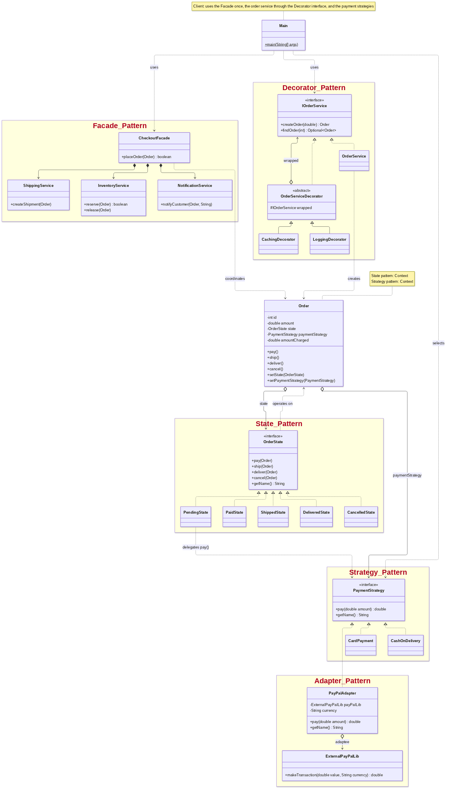

# Homework 2 — Design Patterns 

 تطبيق خمسة أنماط تصميم (State, Strategy, Adapter, Facade, Decorator) على حالة متجر إلكتروني، بلغة **Java** .

## طريقة التشغيل

### من IntelliJ IDEA
1. افتح المشروع، حدّد المجلد `Homework2/src` كـ **Sources Root** (زر أيمن ← Mark Directory as ← Sources Root).
2. شغّل `hw2.Main` للقائمة التفاعلية، أو `hw2.Demo` لتشغيل السيناريوهات تلقائياً.

### قائمة البرنامج
```
1) Create order    2) Select payment method   3) Pay
4) Ship            5) Deliver                 6) Cancel
7) Show status     8) Exit
9) Checkout (Facade: inventory -> payment -> shipping -> notification)
```
الخيار 9 إضافة منّا إلى الخيارات الثمانية المطلوبة، لتظهر الـ Facade أثناء التشغيل بنداء واحد.

## جدول الأنماط

| النمط | الكلاسات المشاركة | مكان الكود | المشكلة التي حلّها |
| --- | --- | --- | --- |
| **State** | `OrderState`، `PendingState`، `PaidState`، `ShippedState`، `DeliveredState`، `CancelledState`، و`Order` (Context) | `src/hw2/state/`، `src/hw2/model/Order.java` | سلوك الطلب يتغير حسب حالته، فاستُبدلت سلسلة `if/else` بكلاس لكل حالة وانتقالات ممنوعة برسائل واضحة |
| **Strategy** | `PaymentStrategy`، `CardPayment`، `CashOnDelivery`، و`Order` (يحمل الاستراتيجية) | `src/hw2/strategy/`، `src/hw2/model/Order.java` | اختيار طريقة الدفع وتبديلها وقت التشغيل دون `if/else` أو `switch`، وإضافة طرق جديدة دون تعديل الدفع |
| **Adapter** | `ExternalPayPalLib` (Adaptee)، `PayPalAdapter` (Adapter)، `PaymentStrategy` (Target) | `src/hw2/adapter/` | واجهة مكتبة PayPal الخارجية تختلف عمّا يتوقعه النظام ولا يجوز تعديلها، فأصبح PayPal استراتيجية ثالثة |
| **Facade** | `CheckoutFacade`، `InventoryService`، `ShippingService`، `NotificationService` | `src/hw2/facade/` | الشراء يحتاج أربع خدمات بترتيب محدد، فصار `Main` يستدعي `placeOrder()` مرة واحدة دون معرفة الخدمات |
| **Decorator** | `IOrderService`، `OrderService`، `OrderServiceDecorator`، `LoggingDecorator`، `CachingDecorator` | `src/hw2/decorator/` | إضافة Logging وCaching إلى خدمة الطلبات دون تعديل الكلاس الأصلي ودون تضخم الكلاسات |


## الفرق بين Strategy وAdapter
النمطان يلتقيان في كلاس واحد هو `PayPalAdapter`، لكن لكلٍّ منهما سؤال مختلف:

|                      | Strategy | Adapter |
|----------------------| --- | --- |
| **السؤال**           | كيف نبدّل **سلوكاً** (طريقة الدفع) وقت التشغيل؟ | كيف نجعل **واجهة غير متوافقة** تعمل مع نظامنا؟ |
| **مثاله في المشروع** | `CardPayment` و`CashOnDelivery` و`PayPalAdapter` بدائل تحقق `PaymentStrategy` | `PayPalAdapter` يترجم `pay(amount)` إلى `makeTransaction(value, currency)` |
| **متى يُحدَّد**      | العميل يختار ويبدّل أثناء التشغيل | عند التصميم، لأن المكتبة خارجية ولا تتغير |
| **الكلاسات**         | كلاسات كتبناها وتصمّمنا واجهتها | كلاس قائم لا نملكه ولا نعدّله |

فبدون Strategy لا توجد واجهة مشتركة نُكيّف إليها المكتبة، وبدون Adapter لا يمكن لـ PayPal أن يصبح إحدى الاستراتيجيات. Strategy يمنحنا **قابلية التبديل**، وAdapter يمنحنا **التوافق**.


## مخطط UML




## مثال تشغيل

 سيناريو ناجخ باستخدام البطاقة البنكية كطريقة دفع.

```text
##### Scenario 1: full valid flow with Bank Card #####
[LOG] createOrder(amount=200.00)
[LOG] createOrder -> created order #1
   [Card] Charged 204.00 (amount 200.00 + 2% card fee)
[OK] Order #1 paid via Bank Card.
[OK] Order #1 shipped.
[OK] Order #1 delivered.
Order #1 | amount: 200.00 | payment: Bank Card | state: Delivered
```

## الفريق

**رقم المجموعة: 33**

| الاسم الثلاثي | الرقم الجامعي | GitHub |
| --- | --- | --- |
| فرح ماجد الهواري | 1722196980 | @farahAlHawari |
| لوليا فايز دياب | 1722164850 | @loulia-diab |
| مريم محمد هاشم عباس | 1722204173 | @mariam-mh-abbas |
| فرح زهير البغدادي | 1722168567 | @Farah88B |
| راما محمود عواد | 1721146456 | @rama3awwad |
