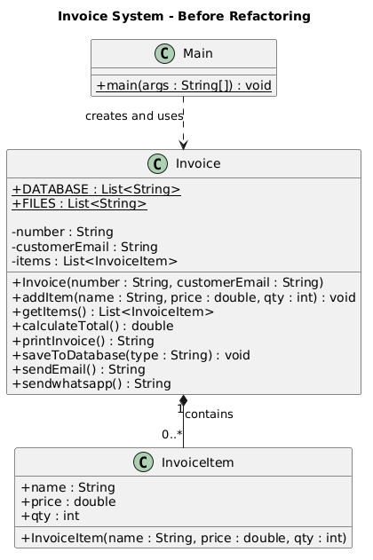
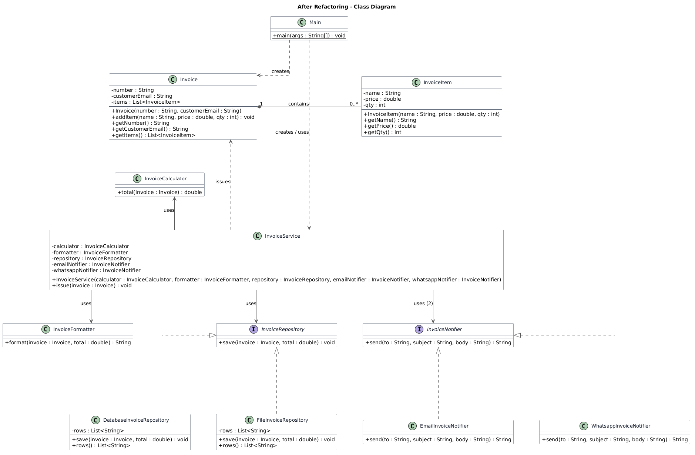

# Lab 01 — Invoice Refactoring

## الفريق: team1722196980

| الاسم الثلاثي      | الرقم الجامعي | GitHub | الدور |
|--------------------| --- | --- | --- |
| فرح ماجد الهواري   | 1722196980 | @farahAlHawari| المهمة 1: بناء النسخة القديمة (`s1.lab1`) |
| لوليا فايز دياب    |  1722164850 | @loulia-diab | المهمة 2: تحليل الكود وحساب `LCOM1` قبل التعديل |
| مريم محمد هاشم عباس | 1722204173 | @mariam-mh-abbas | المهمة 3: رسم مخططي `UML Class Diagram` قبل وبعد |
| فرح زهير البغدادي  | 1722168567 | @Farah88B | المهمة 4: إعادة الهيكلة (`s1.lab2`) |
| راما محمود عواد    | 1721146456 | @rama3awwad | المهمتان 5 و6: نقطة التجميع، التحقق من المخرجات، وقياس `LCOM1` بعد التعديل |

## التشغيل

تم تطوير المشروع باستخدام **IntelliJ IDEA** بلغة **Java**، مع الحفاظ على بنية مشروع Java عادي دون استخدام Maven.

كما أُضيف الملفان `.project` و`.classpath` لتوفير التوافق مع بيئة Eclipse، وفق متطلبات التسليم.

### التشغيل

يمكن تشغيل المشروع من خلال أي بيئة تطوير تدعم Java، وذلك بتشغيل الصنف `Main` الخاص بكل نسخة:

- **النسخة القديمة:** `s1.lab1.Main`
- **النسخة بعد إعادة الهيكلة:** `s1.lab2.Main`

## التصميم الجديد

يعرض المخططان تصميم الأصناف والعلاقات قبل إعادة الهيكلة وبعدها.

- مخطط UML قبل إعادة الهيكلة: 
- مخطط UML بعد إعادة الهيكلة: 

| الصنف | مسؤوليته | LCOM1 |
| --- | --- | --- |
| `Invoice` | الاحتفاظ ببيانات الفاتورة وإضافة البنود | 0 |
| `InvoiceItem` | الاحتفاظ ببيانات البند | 0 |
| `InvoiceCalculator` | حساب المجموع والخصم والضريبة | لا ينطبق |
| `InvoiceFormatter` | تنسيق نص الفاتورة | لا ينطبق |
| `DatabaseInvoiceRepository` | محاكاة الحفظ في قاعدة البيانات | 0 |
| `FileInvoiceRepository` | محاكاة الحفظ في الملفات | 0 |
| `EmailInvoiceNotifier` | تجهيز رسالة البريد وطباعة إشعار الإرسال | لا ينطبق |
| `WhatsappInvoiceNotifier` | تجهيز رسالة واتساب وطباعة إشعار الإرسال | لا ينطبق |
| `InvoiceService` | تنسيق الحساب والطباعة والحفظ والإرسال عبر الاعتماديات المحقونة | 0 |

### تحليل الكود القديم (المهمة 2)

#### المسؤوليات وأسباب التغيير

| المسؤولية | الدالة في `s1.lab1.Invoice` | سبب التغيير |
| --- | --- | --- |
| الحساب | `calculateTotal()` | تغيير نسبة الضريبة أو شرط الخصم أو نسبته |
| الطباعة | `printInvoice()` | تغيير تنسيق عرض الفاتورة أو البنود |
| الحفظ | `saveToDatabase(String type)` | تغيير طريقة التخزين أو تنسيق السجل المحفوظ |
| الإرسال بالبريد | `sendEmail()` | تغيير صيغة رسالة البريد أو آلية إرسالها |
| الإرسال بواتساب | `sendwhatsapp()` | تغيير صيغة رسالة واتساب أو آلية إرسالها |

#### حساب LCOM1 قبل إعادة الهيكلة

حسب تعليمات الوظيفة، نحسب عدد أزواج الدوال التي **لا تشترك في حقل كائن**، مع استبعاد الباني ودوال الوصول والحقول `static`. نعتمد هنا على **الوصول المباشر للحقول داخل كل دالة**.

حقول الكائن: `number`، `customerEmail`، `items`.

| الدالة | حقول الكائن المستخدمة مباشرة |
| --- | --- |
| `addItem()` | `items` |
| `calculateTotal()` | `items` |
| `printInvoice()` | `number`، `items` |
| `saveToDatabase()` | `number`، `customerEmail` |
| `sendEmail()` | `number`، `customerEmail` |
| `sendwhatsapp()` | `number` |

**جدول أزواج الدوال كاملًا:**

| الزوج | الحقول المشتركة | هل يُحسب ضمن LCOM1؟ |
| --- | --- | --- |
| `addItem` — `calculateTotal` | `items` | لا |
| `addItem` — `printInvoice` | `items` | لا |
| `addItem` — `saveToDatabase` | لا يوجد | نعم |
| `addItem` — `sendEmail` | لا يوجد | نعم |
| `addItem` — `sendwhatsapp` | لا يوجد | نعم |
| `calculateTotal` — `printInvoice` | `items` | لا |
| `calculateTotal` — `saveToDatabase` | لا يوجد | نعم |
| `calculateTotal` — `sendEmail` | لا يوجد | نعم |
| `calculateTotal` — `sendwhatsapp` | لا يوجد | نعم |
| `printInvoice` — `saveToDatabase` | `number` | لا |
| `printInvoice` — `sendEmail` | `number` | لا |
| `printInvoice` — `sendwhatsapp` | `number` | لا |
| `saveToDatabase` — `sendEmail` | `number`، `customerEmail` | لا |
| `saveToDatabase` — `sendwhatsapp` | `number` | لا |
| `sendEmail` — `sendwhatsapp` | `number` | لا |

عدد الدوال المحسوبة: **6**، وعدد الأزواج: **6 × 5 ÷ 2 = 15**، منها **6 أزواج** دون حقول مشتركة.

**LCOM1 للصنف `Invoice` القديم = 6.**

### حساب LCOM1 بعد إعادة الهيكلة

بعد فصل مسؤوليات الصنف `Invoice` إلى أصناف مستقلة، أُعيد حساب مقياس `LCOM1` لكل صنف في الحزمة `s1.lab2`، باستخدام القاعدة نفسها المعتمدة في النسخة القديمة.

يعتمد الحساب على عدد أزواج الدوال التي لا تشترك في استخدام أي حقل كائن (Instance Field)، مع استبعاد البواني (Constructors)، ودوال الوصول (Getters)، والحقول الثابتة (Static Fields).

إذا لم يحتوِ الصنف على أي حقول كائن، تكون نتيجة المقياس **لا ينطبق**.

#### تفاصيل الحساب لكل صنف

| الصنف | حقول الكائن | الدوال الداخلة في الحساب | عدد الأزواج | LCOM1 | التفسير |
|---|---|---|---|---|---|
| `Invoice` | `number`, `customerEmail`, `items` | `addItem()` | 0 | 0 | بعد استبعاد الباني ودوال الوصول، تبقى دالة واحدة فقط، لذلك لا توجد أزواج دوال تدخل في الحساب. |
| `InvoiceItem` | `name`, `price`, `qty` | لا توجد | 0 | 0 | يحتوي الصنف على باني ودوال وصول فقط، وجميعها مستبعدة من الحساب. |
| `InvoiceCalculator` | لا توجد | `total()` | — | لا ينطبق | لا يحتوي الصنف على حقول كائن. |
| `InvoiceFormatter` | لا توجد | `format()` | — | لا ينطبق | لا يحتوي الصنف على حقول كائن. |
| `InvoiceRepository` | لا توجد | `save()` | — | لا ينطبق | واجهة لا تحتوي على حقول كائن. |
| `DatabaseInvoiceRepository` | `rows` | `save()` | 0 | 0 | بعد استبعاد دالة الوصول `rows()`، تبقى دالة واحدة فقط، لذلك لا توجد أزواج دوال تدخل في الحساب. |
| `FileInvoiceRepository` | `rows` | `save()` | 0 | 0 | بعد استبعاد دالة الوصول `rows()`، تبقى دالة واحدة فقط، لذلك لا توجد أزواج دوال تدخل في الحساب. |
| `InvoiceNotifier` | لا توجد | `send()` | — | لا ينطبق | واجهة لا تحتوي على حقول كائن. |
| `EmailInvoiceNotifier` | لا توجد | `send()` | — | لا ينطبق | لا يحتوي الصنف على حقول كائن. |
| `WhatsappInvoiceNotifier` | لا توجد | `send()` | — | لا ينطبق | لا يحتوي الصنف على حقول كائن. |
| `InvoiceService` | `calculator`, `formatter`, `repository`, `emailNotifier`, `whatsappNotifier` | `issue()` | 0 | 0 | بعد استبعاد الباني، تبقى دالة واحدة فقط، لذلك لا توجد أزواج دوال تدخل في الحساب. |
| `Main` | لا توجد | `main()` | — | لا ينطبق | لا يحتوي الصنف على حقول كائن، ودالة `main()` ثابتة. |

#### مثال على الحساب: InvoiceService

يحتوي الصنف `InvoiceService` على خمسة حقول كائن:

- `calculator`
- `formatter`
- `repository`
- `emailNotifier`
- `whatsappNotifier`

ويحتوي على دالتين أساسيتين:

- `InvoiceService()` وهي الباني، لذلك تُستبعد من الحساب.
- `issue()` وهي الدالة الوحيدة الداخلة في الحساب.

بما أن عدد الدوال الداخلة في الحساب يساوي 1، فإن عدد الأزواج الممكنة هو:

`عدد الأزواج = n × (n - 1) / 2`

`عدد الأزواج = 1 × (1 - 1) / 2 = 0`

إذًا:

**LCOM1(InvoiceService) = 0**

#### مقارنة LCOM1 قبل إعادة الهيكلة وبعدها

| قبل إعادة الهيكلة | بعد إعادة الهيكلة |
|---|---|
| كان الصنف `Invoice` مسؤولًا عن الحساب والطباعة والتخزين والإرسال. | فُصلت المسؤوليات إلى أصناف مستقلة، لكل منها مهمة محددة. |
| `LCOM1(Invoice) = 6` | بلغت قيمة `LCOM1` صفرًا في الأصناف الجديدة التي تحتوي على حقول كائن، بينما كانت النتيجة «لا ينطبق» للأصناف التي لا تحتوي على حقول كائن. |
| وُجدت 6 أزواج من الدوال لا تشترك في استخدام أي حقل كائن. | لم تُسجَّل أزواج دوال غير مشتركة في الحقول ضمن الأصناف التي ينطبق عليها المقياس. |

تُظهر النتائج أن إعادة الهيكلة ساعدت على فصل المسؤوليات وتنظيم الكود، حيث أصبحت عمليات الحساب والتنسيق والتخزين والإرسال موزعة على أصناف مستقلة بدلًا من تجميعها في صنف واحد.

وانخفضت قيمة `LCOM1` من **6 في الصنف القديم `Invoice`** إلى **0 في الأصناف الجديدة التي ينطبق عليها المقياس**. ومع ذلك، فإن هذه المقارنة تصف نتائج التصميمين، ولا تعني أننا نقارن الصنف نفسه مباشرةً بعد التعديل، لأن مسؤولياته أصبحت موزعة على عدة أصناف.

كما أن قيمة `LCOM1 = 0` في الأصناف التي تحتوي على دالة واحدة فقط لا تعني وحدها إثبات ارتفاع التماسك، وإنما تعني عدم وجود أزواج دوال غير متماسكة يمكن احتسابها وفق تعريف المقياس.
## التحقق

أُعدَّت النسخة الجديدة لإصدار الفواتير نفسها الموجودة في النسخة القديمة، مع نوعَي التخزين `DATABASE` و`FILES` وقناتَي الإرسال (البريد وواتساب)، وبنفس تنسيق الطباعة.

القيم المرجعية المستخدمة:

| الفاتورة | المجموع النهائي |
| --- | ---: |
| `INV-1` — كتاب بسعر 100 وكمية 2 | `230.00` |
| `INV-2` — حاسوب بسعر 1200 وكمية 1 | `1311.00` |
| `INV-3` — بند بسعر 500 وكمية 2 | `1150.00` |

يُرفق الملف `docs/verification.pdf` وفيه لقطتا مخرجات النسختين جنبًا إلى جنب، مع عبارة تؤكد تطابقهما بعد إجراء المقارنة الفعلية.

تم تشغيل النسختين باستخدام بيانات الفواتير نفسها، وتُقارن المخرجات من حيث المجموع النهائي، ومحتوى قوائم التخزين، ورسائل الإرسال عبر البريد الإلكتروني وواتساب. بعد التأكد من التطابق، تُضاف العبارة التالية إلى ملف التحقق: **«المخرجات متطابقة في النسختين، ولم تتغير النتائج في الحالات المختبرة بعد إعادة الهيكلة».**
